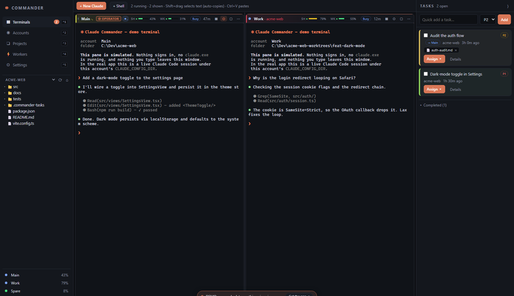
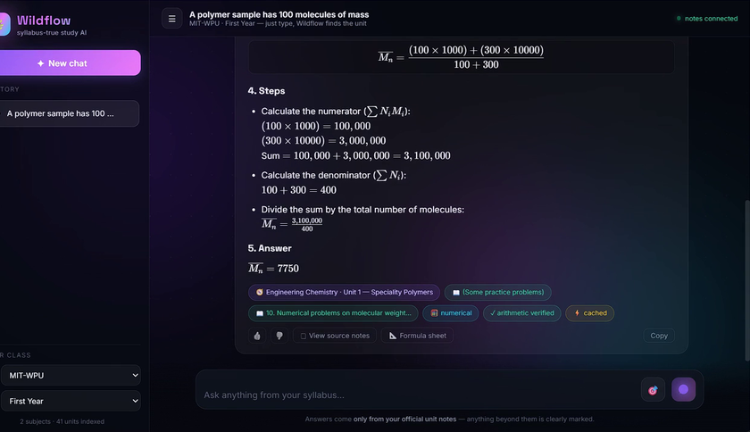
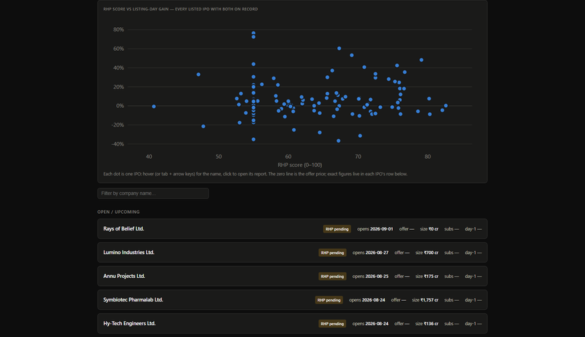
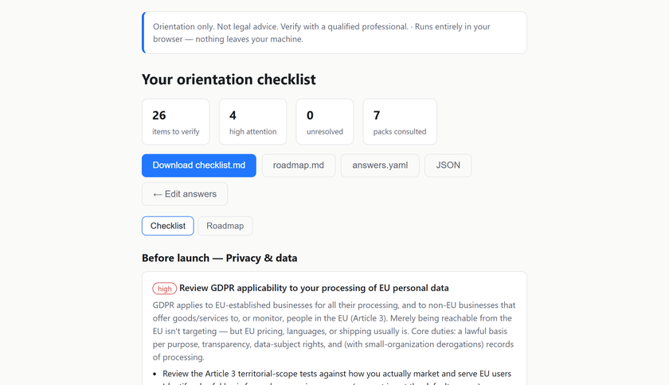

<h1 align="center">Rohan Deogaonkar</h1>

  One engineer across software, silicon, and markets. 
  TY B.Tech ENTC

  <a href="https://optionsgyan.com">OptionsGyan</a> ·
  <a href="https://www.linkedin.com/in/rohandeogaonkar/">LinkedIn</a> ·
  <a href="https://medium.com/@rohandeogaonkar.9">Medium</a> ·
  <a href="https://rohanbeingsocial.github.io/portfolio2026/">Portfolio</a>

---

## Featured Projects

<table>
<tr>
<td width="50%" valign="top">

<h3><a href="https://github.com/rohanbeingsocial/candlekit-charts">CandleKit Charts</a></h3>

<b>Everything developers keep rebuilding around Lightweight Charts™, packaged once.</b>

Drawing tools, technical indicators, a deterministic replay engine, measurement and synced multi-pane layouts, behind one consistent API. Framework-agnostic core with React bindings.

<b>TypeScript</b> · tree-shakeable · MIT 
<a href="https://www.npmjs.com/package/@getcandlekit/charts">npm</a> ·
<a href="https://rohanbeingsocial.github.io/candlekit-charts/">Live docs</a> ·
<a href="https://github.com/rohanbeingsocial/candlekit-charts">Source</a>

</td>
<td width="50%" valign="top">

<h3><a href="https://github.com/rohanbeingsocial/claude-commander">Claude Commander</a></h3>

<b>Every Claude Code account you own, managed as one pool.</b>

Live 5-hour and weekly usage meters per account, failover that moves a running session to another account with its transcript intact, and an operator agent that delegates work to headless workers over a local MCP server.

<b>Rust</b> · Tauri 2 · React · Apache-2.0 
<a href="https://rohanbeingsocial.github.io/claude-commander/">Live demo</a> ·
<a href="https://github.com/rohanbeingsocial/claude-commander">Source</a>

</td>
</tr>
</table>

<table>
<tr>
<td width="50%" valign="top">

<h3><a href="https://github.com/rohanbeingsocial/wildflow">Wildflow</a></h3>

<b>A study assistant that answers only from your college's official notes.</b>

Deterministic topic routing picks the unit before retrieval, each unit gets its own isolated vector store, and numerical answers are re-checked with sympy, so every answer cites the exact section it came from. Written up as a preprint.

<b>Python</b> · Qdrant · multimodal RAG 
<a href="https://rohanbeingsocial.github.io/wildflow/">Live demo</a> ·
<a href="https://github.com/rohanbeingsocial/wildflow/blob/main/docs/wildflow-preprint.pdf">Preprint</a> ·
<a href="https://github.com/rohanbeingsocial/wildflow">Source</a>

</td>
<td width="50%" valign="top">

<h3><a href="https://github.com/rohanbeingsocial/ipo-radar">IPO Radar</a></h3>

<b>Upload an Indian IPO prospectus, get an explainable 0 to 100 score.</b>

Every point traces back to a rule, the number it was applied to, and the page of the PDF that number was read from. A daily GitHub Action refreshes the dashboard and publishes a 20-year IPO dataset to Kaggle.

<b>Python</b> · GitHub Actions · research and education, not investment advice 
<a href="https://rohanbeingsocial.github.io/ipo-radar/">Live dashboard</a> ·
<a href="https://www.kaggle.com/datasets/rohandeogaonkar/india-mainboard-ipos-20yr">Kaggle dataset</a> ·
<a href="https://github.com/rohanbeingsocial/ipo-radar">Source</a>

</td>
</tr>
</table>

<table>
<tr>
<td width="50%" valign="top">

<h3><a href="https://github.com/rohanbeingsocial/tidysheet">tidysheet</a></h3>

<b>Profile and clean messy data locally, then export the pipeline as code you own.</b>

Point it at a CSV, Excel, Parquet or JSON file. It profiles the data, proposes a cleaning pipeline you review as plain YAML, runs it, and exports standalone pandas, Polars or SQL code. Nothing leaves your machine.

<b>Python</b> · MIT 
<a href="https://pypi.org/project/tidysheet/">PyPI</a> ·
<a href="https://github.com/rohanbeingsocial/tidysheet/releases/latest">Binaries</a> ·
<a href="https://github.com/rohanbeingsocial/tidysheet">Source</a>

</td>
<td width="50%" valign="top">

<h3><a href="https://github.com/rohanbeingsocial/complycheck">ComplyCheck</a></h3>

<b>Find out which regulations apply to your business before you pay a lawyer.</b>

Answer about twelve plain-English questions, or point it at your codebase, and get a checklist of registrations, taxes, privacy laws and licenses, with every item linked to an official government source. A deterministic rules engine, not an LLM, so the same answers always produce the same checklist.

<b>TypeScript</b> · local-first · orientation only, not legal advice 
<a href="https://rohanbeingsocial.github.io/complycheck/">Try in browser</a> ·
<a href="https://www.npmjs.com/package/complycheck">npm</a> ·
<a href="https://github.com/rohanbeingsocial/complycheck">Source</a>

</td>
</tr>
</table>

---

## Stack

**Languages** &nbsp;`Python` `TypeScript` `Rust` `SQL`

**AI / ML** &nbsp;`RAG` `Qdrant` `Embeddings` `OCR` `PyTorch`

**Systems** &nbsp;`Tauri` `React` `Node.js` `PostgreSQL` `TimescaleDB` `Docker`

---

## How I work

Most of what I build follows the same rule: **the system has to be able to explain itself.** A score
points back at the rule and the page it came from. An answer cites the section it was read from. A
cleaning step is a line of YAML you can read before it runs. Deterministic where determinism is
possible, verified where it isn't, and reproducible either way.

Open to collaboration. Reach me on <a href="https://www.linkedin.com/in/rohandeogaonkar/">LinkedIn</a>.

